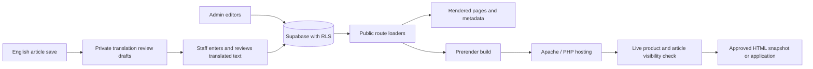

# Tuxar task map

| Task | Start here |
|---|---|
| Deployment / HTTPS / rollback | `.github/workflows/deploy.yml`, `scripts/ci/hosting.py`, `scripts/ci/smoke.mjs` |
| HTTP 404 / immediate unpublishing | `public/.htaccess`, `public/server-router.php`, `scripts/prerender-public-pages.mjs` |
| Blog publication / legacy fallback | `src/lib/blog/published.ts`, `src/lib/blog/content.ts`, `blog_publication_states` |
| Blog date / typography / images | `src/lib/blog/date.ts`, `src/styles.css` (`journal-content`), `src/assets/index.ts`, `vite.config.ts` |
| Blog list / detail / SEO | `src/routes/$locale.blog.index.tsx`, `src/routes/$locale.blog.$slug.tsx` |
| Blog editor / draft recovery | `src/components/admin/AdminArticleEditor.tsx`, `RichTextEditor.tsx`, `src/lib/article-draft.ts` |
| Translations / review | `AdminArticleTranslations.tsx`, `blog_translation_drafts`, migration `202611210002_content_publication.sql` |
| General page content | `src/components/admin/AdminPages.tsx`, `src/lib/site-pages.ts`, `src/components/site/ManagedPageContent.tsx`, `src/routes/$locale.tsx` |
| Collection name / descriptions / SEO | `AdminCategoryEditor.tsx`, `src/lib/collection-content.ts`, `storefront-collection-content.ts`, `$locale.collections.$slug.tsx` |
| Prices / publication | `src/lib/storefront-products.ts`, `AdminProductEditor.tsx` |
| Variant stock / buying controls | `src/lib/product-inventory.ts`, `$locale.product.$slug.tsx`, `src/hooks/useCartInventory.ts` |
| Checkout validation | `supabase/functions/create-checkout-session`, `create-cod-order` |
| Header / currency / footer | `src/components/site/Header.tsx`, `Footer.tsx` |
| Banner editing | `AdminBannerEditor.tsx`, `AdminHomepageBanner.tsx`, homepage-slides helpers |

Page content: seven informational pages allow full body replacement. Home, shop, contact, category landing pages and Journal allow editable introductions while preserving controls. Product, collection, article and banner content use their dedicated editors. Account, authentication and payment logic are code, not editable CMS content.

Published database edits appear on fresh client navigation. Initial HTML content/SEO updates still need the existing publish workflow, clearly linked in admin. Product/article URLs check live publication before serving snapshots, and generated article/product cards are filtered against current publication status on the server. Visibility tombstones prevent archived/deleted bundled blogs returning. A successful status check must not be cached across requests.

Translations: no API configured. English edits queue private review workspaces, retain previous translation text, and never silently overwrite published translations. Translate text manually (including assistance in chat), then explicitly publish after review. English source revision is checked again by the database. `blog_posts.translation_source_id` links reviewed language versions; public article loaders and the header use only published language URLs. Untouched bundled translations remain available unless explicitly archived.

Tests: targeted Node security tests, `npm run typecheck`, `npm run lint`, Python hosting/router checks. PHP CLI is available in CI, not on this Windows machine. Avoid parallel fixture-writing test files.
